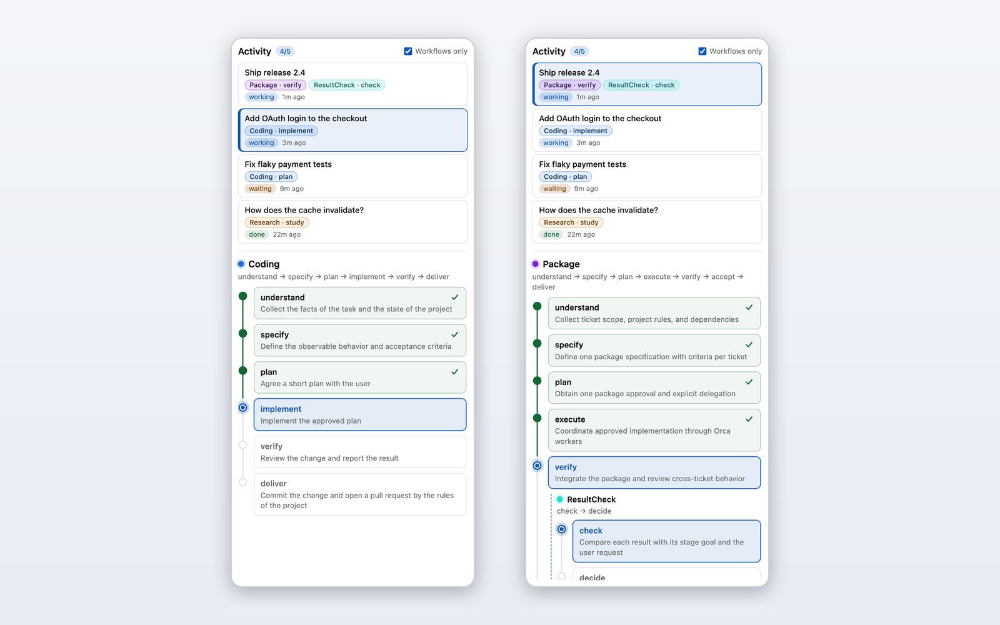

# PI Workflow Status

An [Orca](https://onorca.dev) plugin that shows, for every agent in every local workspace, which
[Pi](https://www.npmjs.com/package/pi-agent-suite) workflow it is running and which stage it is in.



## What it shows

- **Activity**: all agents of all local workspaces, running ones first. Every agent that runs a
  workflow carries one chip per level, for example `Coding · implement`, plus its state and the
  time since its last state change. The **Workflows only** switch hides agents without an active
  workflow; it is on by default and remembered.
- **Pipeline** of the selected agent: every stage of the workflow definition with its
  description, done stages in green, the current stage in blue, pending ones in grey. A check
  workflow such as `ResultCheck` appears indented below the current stage.
- The list and the pipeline scroll independently; the page itself does not scroll.

Agents without a Pi session, for example Claude Code, show `no workflow`. The panel is available
in the Orca desktop app.

## Jobs on other computers

Pi session files live on the computer that runs the job. To show jobs of a paired Orca server (one
you added with `orca environment add`), the plugin asks the same plugin on that server:

```sh
orca plugin dev request local.pi-workflow-status jobs.list --data '{"includeRemote":false}' --environment <server>
```

Orca answers this only for a plugin loaded as a development folder, so on each server run
`orca plugin dev load <folder of this repository>`. Jobs of a server show its name; workspaces of
other hosts without an answering plugin show their agents with `workflow not readable`. Remote jobs
refresh with the panel, at most every 15 s.

## Requirements

- Orca 1.4.259 or later
- Pi with Pi Agent Suite workflows, which write `workflow-state` entries into Pi's session files

## Install

```sh
orca plugin install dom8509/pi-workflow-status
```

Orca asks you to approve the access the plugin needs:

| Capability | Why |
|---|---|
| `workspace:read` | list your workspaces and their paths |
| `agent:read` | list agents and react to their state changes |
| `history:read` | name agents by the title of their session in Orca's session history |
| `settings:own` | read the sessions folder setting |
| `storage:own` | remember the **Workflows only** switch |

The plugin runs as a `trusted-worker`, a Node process with your user's file access. It reads only
files that, after resolving symbolic links, lie below the sessions folder. It calls the `orca` CLI
for `orca agent list --json` (tab titles Orca's history does not have), `orca environment list`
and `orca plugin dev request … --environment` (jobs of paired servers).

## Settings

In Settings → Plugins → PI Workflow Status:

- **Pi sessions folder**: where Pi stores its session files, `~/.pi/agent/sessions` by default.
- **Remote Orca servers**: names or ids of paired servers to ask, separated by commas; empty asks
  every saved server.

## How it works

- `src/worker.ts` lists all workspaces (`workspace.list`) and their agents (`agents.list`). For
  each Pi agent it finds the session file by the `sessionId` Orca reports; without a match it
  takes the newest session in the workspace's folder, but only when exactly one Pi agent runs there.
- `src/parse.ts` reads the `workflow-state` entries (`activated`, `transitioned`, `exited`) along
  the session's current branch and builds the workflow stack.
- Agent names come from Orca's session history (`agent.listSessions`), matched exactly by
  `sessionId`. Without a match the worker uses a tab title from `orca agent list --json`, but only
  when exactly one agent of that kind runs in the workspace.
- The worker watches the sessions folder and notifies the panel 500 ms after a session changes.
  The panel also refreshes on agent state changes, workspace changes, when it becomes visible, and
  every 15 s while visible, which keeps the worker and its watcher alive.
- `src/view.ts` renders the list and the pipeline as HTML; `src/panel/main.ts` is the HTML panel
  and `src/panel/style.ts` its styles. Surfaces and text use Orca's theme variables; state colours
  and one fixed hue per workflow come from an own palette with a light and a dark variant.

## Develop

```sh
orca plugin test .        # unit tests: parser, sessions, worker, view model, filter store
orca plugin validate .
orca plugin dev load .    # load this folder into Orca
orca plugin shot local.pi-workflow-status   # screenshot of the loaded panel
```

## License

[MIT](LICENSE)
